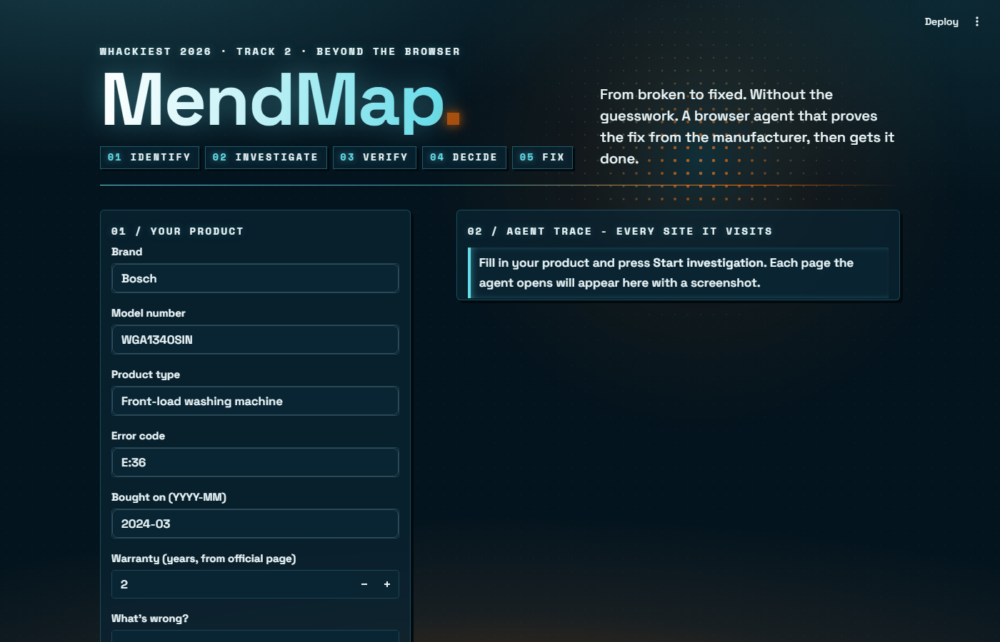
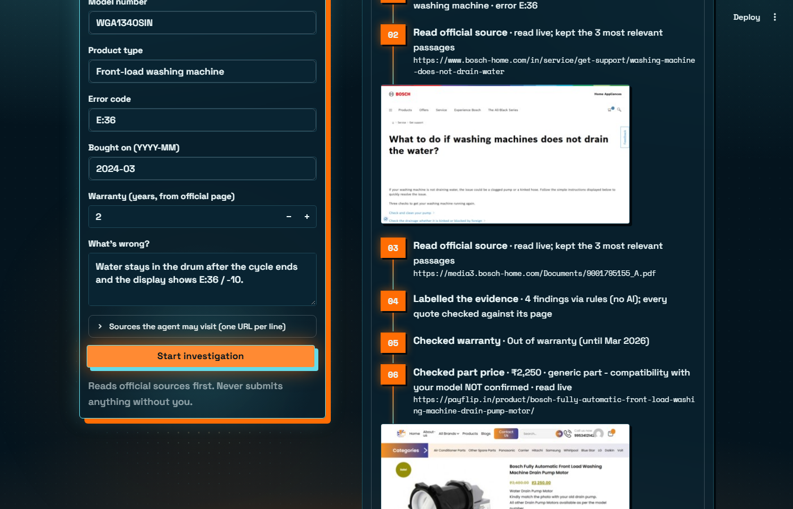

# MendMap

**From broken to fixed. Without the guesswork.**
wHACKiest 2026 · Track 2: Beyond the Browser

MendMap is a browser agent for repairs. Tell it your exact product, error code and purchase date. It opens the official support pages and manuals in a real browser, labels every finding with evidence (Verified / Likely / Unknown / Unsafe), checks warranty and part prices, pre-fills the service request **and stops before Submit**. Everything ends up in a shareable **Repair Passport**, with an **Agent Trace** showing every site visited.

> Other repair bots guess from a photo. MendMap proves it from the manufacturer, then gets it fixed.



## Demo case (real, official sources)

**Bosch WGA1340SIN** front-load washing machine showing **`E:36 / -10`** (water not draining).

| What the agent reads | Source |
|---|---|
| Official support page | [Bosch India - washing machine does not drain](https://www.bosch-home.com/in/service/get-support/washing-machine-does-not-drain-water) |
| Official manual (PDF) | [WGA1340SIN user manual](https://media3.bosch-home.com/Documents/9001795155_A.pdf) |
| Drain pump prices | Payflip · Amazon.in |

Result: **Verified** - *"E:36 / -10" Drain pipe or water outlet hose is blocked* (manual, page 37), plus Likely steps
from Bosch India, warranty status, the cheapest part (flagged as a generic part whose fit is not confirmed),
and a pre-filled service request that stops before Submit.



## What you see while it works

- **Live Agent Trace** - a numbered timeline of every step, with a **screenshot of every web page the agent opens**.
- **Evidence labels** - Verified / Likely / Unknown / Unsafe, each with the exact quote, source URL and PDF page.
- **Honest prices** - reads the real selling price (skips struck-out MRPs) and says whether the shop page names your exact model.
- **Privacy** - declines optional cookies, and strips the "Delivering to <area PIN>" text from screenshots and cached pages.

## How it works

```
Your product + error code + purchase date
        ↓
1 IDENTIFY     exact model
2 INVESTIGATE  Playwright opens official support pages + manual PDFs
3 VERIFY       AI labels evidence: Verified / Likely / Unknown / Unsafe
               + every quote is checked against the real page (no made-up quotes)
4 DECIDE       warranty status + part prices + repair-vs-replace
5 FIX          pre-fills the service request form, STOPS before Submit
        ↓
Repair Passport (HTML/JSON) + Agent Trace
Extras: hear it in English/Hindi/Kannada (ElevenLabs) · draft a complaint if the brand refuses
```

## Tech stack

| Part | Tool |
|---|---|
| Browser agent | Python + Playwright (headless Chrome) |
| AI brain | AWS Bedrock or Google Gemini (or `mock` rules, no AI) |
| Manuals | pypdf |
| Website | Streamlit |
| Voice | ElevenLabs text-to-speech |

## Run it

```bash
pip install -r requirements.txt
playwright install chromium
cp .env.example .env        # then edit .env
streamlit run app.py
```

Open http://localhost:8501 and press **Start investigation** (a live run takes about 40 seconds).

- Works with no API keys: `LLM_PROVIDER=mock` labels evidence with simple rules. Add a Gemini key or AWS Bedrock
  model in `.env` for AI labelling, and ElevenLabs keys for the voice summary.
- The demo case's pages are cached in `cache/`, so it still runs if a site is down or there is no internet.
- To try another product, edit `demo_case.json` (or the form): brand, model, error code, official support page,
  manual PDF, and part shop pages. If a site blocks bots, save its text to a file and use `local:path/to/file.txt`.

## Safety and control

- Reads official sources first. Every claim shows its source and quote.
- A quote that can't be found on the page is downgraded to **Unknown**.
- Electrical, gas, motor and battery work is always **Unsafe**: call a technician.
- Never submits forms, never pays. The user makes every final click.

## Honest limits (MVP)

- The service request form is a demo copy. Real brand forms differ.
- Part prices are read from the shop page; generic "suitable for" parts are flagged, always double-check the fit.
- Warranty is calculated from the purchase date and period you enter.
- Source URLs are given by the user for now (search engines block automated searching).

## Roadmap

Auto-find official sources via each brand's own site search · real brand service booking (stop before OTP/Submit) ·
nearest authorised service centre by PIN code · invoice / rating-label photo to model and purchase date ·
Hindi/Kannada voice input · National Consumer Helpline escalation · Right to Repair Portal India integration.
